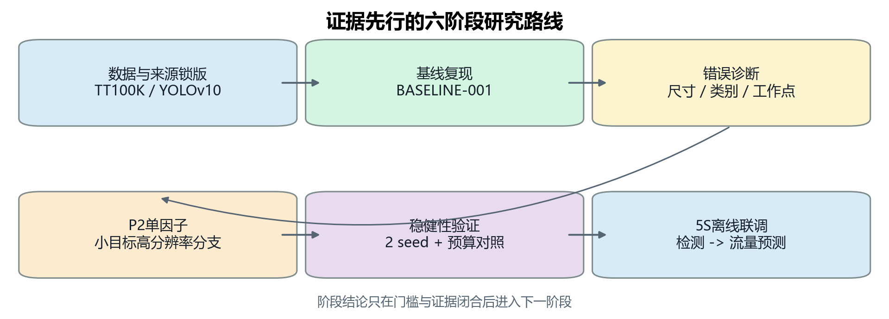
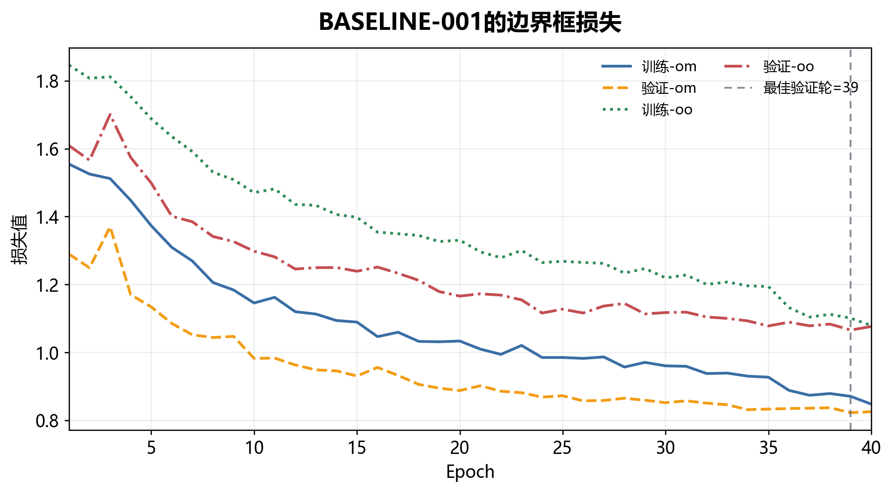
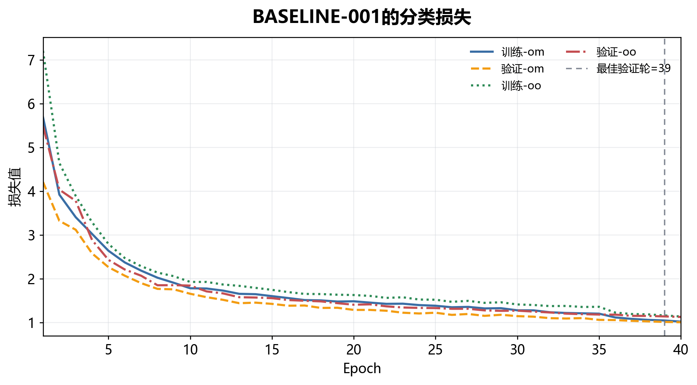
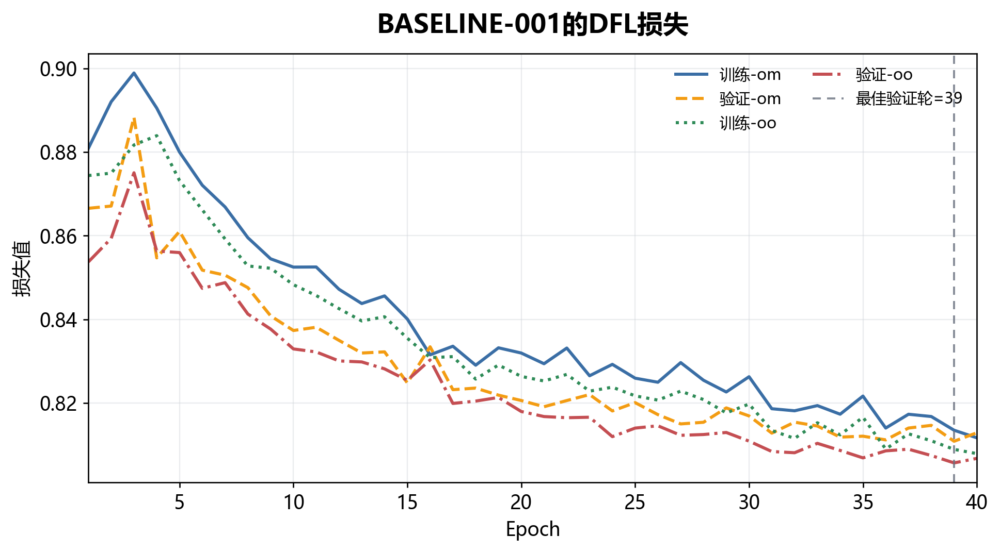
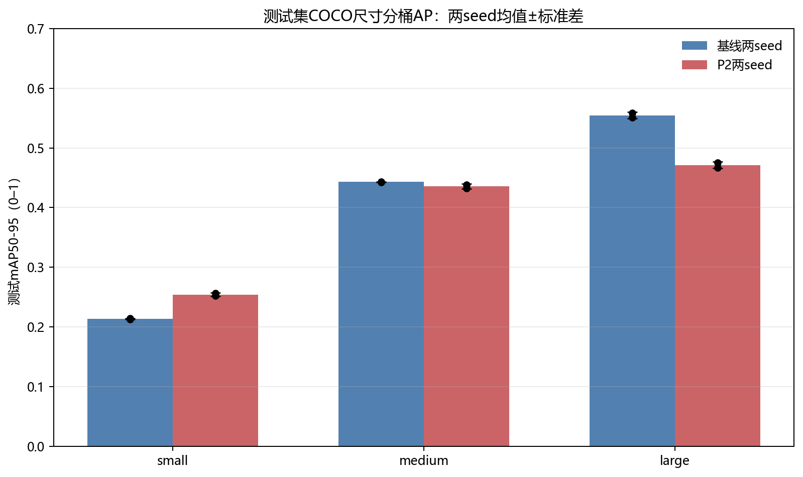
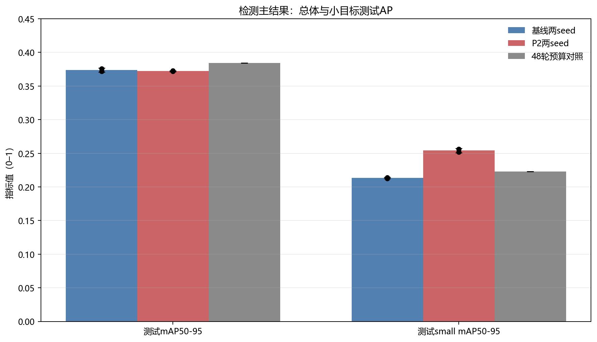
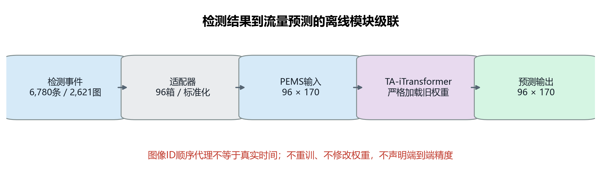
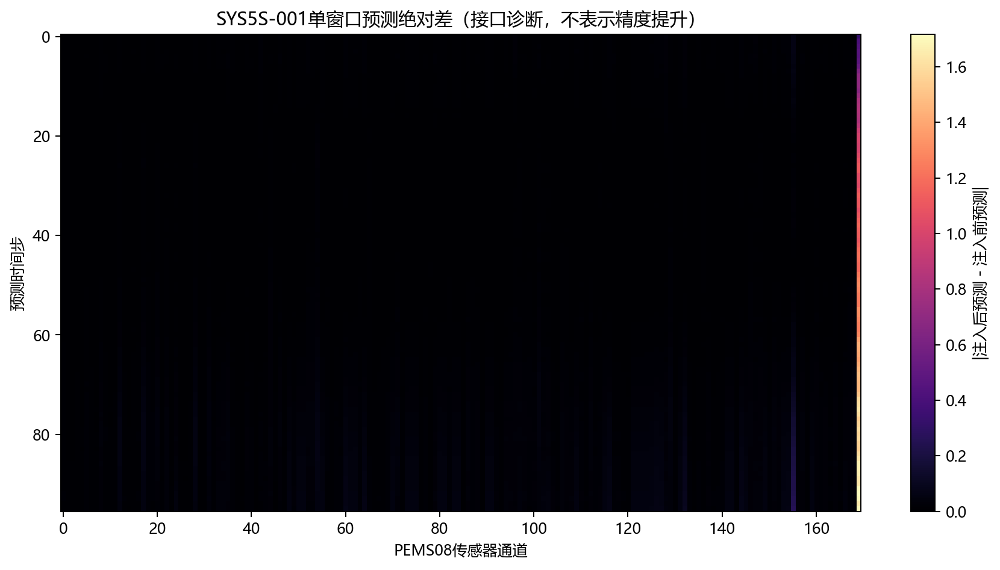

# 基于TT100K的交通标志小目标检测复现与验证性改进

## 摘要

针对TT100K交通标志小目标占比高、类别长尾显著的问题，本文在固定单机算力下完成YOLOv10-N的45类迁移训练与原始预测复算，测试mAP50为0.500520，mAP50-95为0.375802。冻结预测诊断表明，小目标占测试真实框的42.8497%，却占全部漏检的70.2796%。据此设计可单独关闭的P2高分辨率分支。相同seed下，small mAP50-95由0.212520提高到0.256332，但总体mAP50-95由0.375802降至0.372658，大目标AP和推理时延同时增加。两个seed的小目标增益分别为0.043813和0.037868，48轮预算对照的small AP为0.222883。最终保留BASELINE-001，P2作为负结果与权衡实验。拓展部分完成检测结果到TA-iTransformer的离线模块级联，但两类数据不存在真实时空对应，结论仅限接口与数据流验证。

## 关键词

TT100K；YOLOv10；小目标检测；P2特征融合；可复现实验；离线模块级联

## 一、研究背景与意义

### 1.1研究背景

交通标志以限速值、禁止方向、道路编号和提示信息约束车辆行为。真实道路图像中的标志通常只占很小区域，还会受到逆光、阴影、遮挡、透视形变和雨雾影响。不同类别的样本数量差异明显，常见标志远多于低频标志。交通标志检测因此同时面临小目标定位、多类别细粒度分类和长尾分布三个问题。

本文使用Tsinghua-Tencent 100K 2016标注数据（TT100K）及官方type45类别集合[2]。该数据同时包含大量小目标和长尾类别，适合把“总体指标是否提高”拆成错误来源诊断和单因子机制验证。

主模型选择YOLOv10-N（Nano规模）。该模型适合单张8GiB显卡完成基线、改进和多种子实验，一致双重分配和NMS-free推理也便于分析检测头与损失函数。COCO预训练权重仅用于初始化，所有性能判断均以TT100K测试结果为准。

本文的主问题是：在固定单机算力和TT100K-45类划分下，检测错误主要来自哪里；增加可单独关闭的P2高分辨率分支能否改善小目标检测，同时保持总体性能可接受。拓展问题是在基础检测结果明确后，能否把结构化检测结果接入交通流预测模块，形成边界清楚的离线模块级联。

图1-1给出整体研究路线。

**图1-1：从数据锁版到离线模块级联的研究路线**

### 1.2国内外研究现状与模型选择

近三年的实时目标检测研究主要沿单阶段卷积网络和端到端集合预测两条路线发展。YOLOv9通过可编程梯度信息（PGI）和广义高效层聚合网络（GELAN）改善深层特征的信息传递[5]；RT-DETR以Transformer集合预测实现无需非极大值抑制（NMS-free）的实时检测[6]；YOLOv10在YOLO框架内采用一致双重分配，同时构造一对多和一对一监督，使推理阶段直接输出去重后的检测集合[1]。

三类路线各有侧重。YOLOv9强调梯度信息与特征复用，RT-DETR强调端到端集合预测，YOLOv10强调训练监督与推理后处理的统一。本文需要在一台8GiB显存设备上完成基线、改进、第二seed和训练预算对照，并保持官方实现与预训练权重可复核，因此选择YOLOv10-N作为正式实验框架，将另外两类方法作为路线参照。

表1-1给出候选路线的比较与选择依据。

**表1-1：候选目标检测路线比较**

|路线|代表工作|核心机制|主要优势|本项目选择|
|---|---|---|---|---|
|改进单阶段YOLO|YOLOv9|PGI、GELAN|增强深层特征的信息传递|作为技术路线参考|
|端到端YOLO|YOLOv10|一致双重分配、NMS-free|官方实现完整，推理流程简洁|作为正式实验框架|
|实时DETR|RT-DETR|Transformer集合预测|端到端表达清晰|作为对比路线参考|

复现研究的关键不仅在于结果数值，还在于数据划分、随机种子、训练预算和指标复算方式是否一致。本文先建立可复算基线，再从冻结预测中诊断错误，随后只改变P2结构因素，补做第二seed和48轮预算对照，最后讨论模型取舍。

本文工作分为三部分。第一，完成YOLOv10-N在TT100K-45类固定划分上的迁移训练，保存配置、权重、逐轮指标和原始测试预测。第二，从尺寸分桶、类别混淆和固定工作点错误结构中确认小目标漏检的主要方向。第三，在两个seed和48轮预算对照下评估P2分支的收益与代价，并把检测结果接入前期课程项目的TA-iTransformer流量预测模块[3]，完成离线联调。

## 二、模型介绍

### 2.1YOLOv10-N模型概述

YOLOv10-N由骨干网络、特征融合颈部、检测头、训练策略和预训练权重组成。基线训练将80类COCO预训练权重迁移到TT100K的45类，只重建与类别数相关的分类输出，其余兼容张量按形状加载。迁移前对官方权重与训练权重逐张量核验，避免初始化差异进入对比实验。

基线输入尺寸为640×640，批大小（batch size）为8，最大训练40轮，使用随机梯度下降（SGD）和自动混合精度（AMP），最后5轮关闭Mosaic。训练随机种子（seed）为2026，数据读取采用单进程方式以降低Windows环境下的不确定性。验证集用于选择最佳权重，测试集只在权重冻结后执行一次正式测试前向。

YOLOv10-N参数量为2,724,590。当前工具对检测头返回的GFLOPs不可信，因此本文以参数量和同一验证器口径下的单图时延描述工程成本。时延只用于本项目内部比较，不等同于TensorRT等部署后端的实际FPS。

### 2.2核心网络结构与P2分支

输入图像经过骨干网络逐级下采样，形成不同分辨率的特征。浅层特征保留边缘、颜色和小区域位置，深层特征包含更大的感受野和更强的语义信息。颈部网络融合上、下采样特征，检测头在多个尺度上完成分类和边界框回归。640输入下，基线P3、P4、P5特征图尺寸分别为80×80、40×40和20×20，对应下采样步长stride8、16和32。

基线P3已经能够覆盖一般目标，但10至20像素的交通标志经过多次下采样后，空间细节明显减少。错误诊断显示，小目标漏检在测试集和验证集中同向出现，并在同一类别内部持续存在，因此需要保留更高分辨率的浅层特征。

P2分支保留基线前部网络，在stride4尺度增加一条浅层特征路径。P3特征上采样后与骨干P2特征拼接，经C2f特征融合模块形成64通道P2特征，特征图尺寸为160×160。检测头由P3/P4/P5扩展为P2/P3/P4/P5。P2分支通过独立配置启用，其他结构、数据增强和损失函数保持不变。

### 2.3损失函数

YOLOv10训练采用一致双重分配。一对多分支为真实框匹配多个候选预测，提供较密集的监督；一对一分支为每个真实框选择唯一正样本，使推理阶段直接获得去重后的检测集合。

边界框与预测框的重叠程度用IoU表示：

$$
\mathrm{IoU}(B,B^{gt}) =
\frac{|B\cap B^{gt}|}{|B\cup B^{gt}|}
\tag{2-1}
$$

分类分支对类别预测采用二元交叉熵：

$$
\mathcal{L}_{BCE}
=-\frac{1}{N}\sum_{i=1}^{N}
\left[
y_i\log \hat{y}_i+
(1-y_i)\log(1-\hat{y}_i)
\right]
\tag{2-2}
$$

式中，\(N\)为参与分类损失计算的预测-类别对数量，\(y_i\)为类别目标，\(\hat{y}_i\)为预测概率。

边界框回归采用完全交并比（CIoU）损失。设预测框中心为\(b\)，真实框中心为\(b^{gt}\)，中心距离平方为\(\rho^2(b,b^{gt})\)，最小外接框对角线长度为\(c\)，长宽比一致性项为\(v\)，则：

$$
v=
\frac{4}{\pi^2}
\left[
\arctan\left(\frac{w^{gt}}{h^{gt}}\right)-
\arctan\left(\frac{w}{h}\right)
\right]^2
\tag{2-3}
$$

$$
\alpha=
\frac{v}{(1-\mathrm{IoU})+v}
\tag{2-4}
$$

式中，\(w,h\)为预测框宽度和高度，\(w^{gt},h^{gt}\)为真实框宽度和高度。

$$
\mathcal{L}_{CIoU}
=1-\mathrm{IoU}
+\frac{\rho^2(b,b^{gt})}{c^2}
+\alpha v
\tag{2-5}
$$

分布焦点损失（DFL）将边界距离建模为离散概率分布。设第\(i\)个边界区间的类别目标为\(y_i\)，预测logit为\(z_i\)，则：

$$
\mathcal{L}_{DFL}
=-\sum_{i=0}^{n-1}
\left[
y_i\log\sigma(z_i)+
(1-y_i)\log(1-\sigma(z_i))
\right]
\tag{2-6}
$$

式中，\(n\)为边界离散区间的数量，\(\sigma(\cdot)\)为Sigmoid函数。

每个匹配分支的损失为三项加权和：

$$
\mathcal{L}_{branch}
=\lambda_{box}\mathcal{L}_{CIoU}
+\lambda_{cls}\mathcal{L}_{BCE}
+\lambda_{dfl}\mathcal{L}_{DFL}
\tag{2-7}
$$

记一对多分支损失为\(\mathcal{L}_{1:N}\)，一对一分支损失为\(\mathcal{L}_{1:1}\)，总损失为：

$$
\mathcal{L}_{total}
=\mathcal{L}_{1:N}
+\mathcal{L}_{1:1}
\tag{2-8}
$$

### 2.4检测评价指标

设类别\(c\)的Precision-Recall曲线为\(p_c(r)\)，该类别的平均精度定义为：

$$
AP_c=\int_0^1 p_c(r)\,\mathrm{d}r
\tag{2-9}
$$

对\(C\)个类别取平均得到：

$$
\mathrm{mAP}=\frac{1}{C}\sum_{c=1}^{C}AP_c
\tag{2-10}
$$

COCO实现使用101个召回点对连续AP进行离散近似。mAP50表示IoU阈值为0.50时的mAP，mAP50-95表示IoU阈值从0.50到0.95、步长0.05的十档平均。评价协议采用COCO定义[7]，本文同时报告尺寸分桶AP、每图最多100个检测的平均召回率（AR100）和固定工作点错误结构。

## 三、实验设计与结果分析

### 3.1数据集与预处理

TT100K-2016标注包已完成文件校验和数据锁版。原始train与test中存在6个相同图像编号，处理时保留测试身份并从训练候选移除。剩余训练候选按固定哈希规则排序，取十分之一构成验证集，训练集、验证集和测试集之间不存在图像身份重叠。

实验固定使用type45类别。45个类别在训练集中均有实例，样本最多的pn类包含1,692个训练框，最少的p6类包含62个，最大与最小支持度之比约为27.29；15个类别的训练实例少于100个。该分布使模型同时面临高频类主导和小样本类识别困难。

表3-1给出最终固定划分。

**表3-1：TT100K-45类固定数据划分**

|划分|图像数|标注框数|用途|
|---|---:|---:|---|
|训练集|5,489|13,923|参数更新|
|验证集|610|1,553|选择最佳权重与诊断确认|
|测试集|3,071|7,706|冻结模型最终评估|

图像由官方原始标注转换为一图一文件的目标检测标签，类别编号固定为0至44。转换后检查图像与标签一一对应、坐标范围、类别连续性及数据划分重叠，并用确定性抽样图像进行人工目视确认。测试图像没有进入训练或验证。

### 3.2实验环境与训练设置

实验在Windows单机环境完成。GPU为NVIDIA GeForce RTX 4060 Laptop GPU，显存8,188MiB；CPU为Intel Core i9-12900HX，内存15.7GiB。软件环境包括Python3.10.6、PyTorch2.0.1+cu118、torchvision0.15.2+cu118、CUDA11.8和NumPy1.26.4。

基线训练完成40轮，耗时17,776.8秒，最佳验证轮为第39轮。所有检测实验共享同一数据划分、预训练初始化、输入尺寸、batch、优化器和AMP设置。seed2026与seed2027只改变随机种子，48轮实验只延长训练轮数。

**表3-2：检测实验训练配置**

|实验|seed|训练轮数|输入尺寸|batch|最佳验证轮|
|---|---:|---:|---:|---:|---:|
|BASELINE-001|2026|40|640|8|39|
|BASELINE-002-S2027|2027|40|640|8|39|
|P2-001|2026|40|640|8|38|
|P2-002-S2027|2027|40|640|8|39|
|BASELINE-BUDGET48-S2026|2026|48|640|8|47|

表3-2中的实验组成三种对照。第一种比较同一训练预算下的BASELINE-001与P2-001，用于判断P2分支的净效果；第二种比较seed2026与seed2027，用于检查小目标收益是否依赖随机初始化；第三种使用48轮基线，用于判断更长训练能否替代P2分支。

### 3.3BASELINE-001结果

BASELINE-001的测试结果由保存的原始预测独立复算。mAP50为0.500520，mAP50-95为0.375802；small、medium和large目标的mAP50-95分别为0.212520、0.443357和0.558442，AR100为0.722476。检测框架内置评估得到mAP50为0.501、mAP50-95为0.376，与独立复算处于相同精度范围。

**表3-3：BASELINE-001测试指标**

|指标|框架内置值|独立复算值|说明|
|---|---:|---:|---|
|mAP50|0.501000|0.500520|主结果采用复算值|
|mAP50-95|0.376000|0.375802|主结果采用复算值|
|small AP|—|0.212520|像素面积小于\(32^2\)|
|medium AP|—|0.443357|像素面积为\(32^2\)至\(96^2\)|
|large AP|—|0.558442|像素面积大于\(96^2\)|
|AR100|—|0.722476|每图最多保留100个检测|

图3-1(a)至图3-1(c)分别给出训练和验证阶段的边界框损失、分类损失与DFL损失。三类损失在训练前期快速下降，随后趋缓，最佳验证轮附近没有出现非有限值或突然反弹。曲线用于确认训练过程稳定，模型效果仍由测试指标和错误结构判断。

**图3-1(a)：BASELINE-001边界框损失**

**图3-1(b)：BASELINE-001分类损失**

**图3-1(c)：BASELINE-001的DFL损失**

### 3.4错误结构分析

图3-2对比基线与P2在两个seed中的尺寸分桶AP。基线small目标的测试mAP50-95为0.212520，明显低于medium的0.443357和large的0.558442。

**图3-2：基线与P2的测试集尺寸分桶AP**

测试集包含7,706个真实框，其中small目标为3,302个，占42.8497%；2,325个漏检中有1,634个来自small目标，占70.2796%。验证集方向一致，small目标占真实框的46.3619%，占漏检的75.3653%。小目标在漏检中的占比高于其在真实框中的占比，说明尺度信息不足会显著放大漏检风险。

类别混淆主要集中在速度限值族。测试集930个错类中，速度限值族内部混淆为388个；最大方向是pl60被预测为pl40，共52个。近定位失败只有11个，错误更多来自未召回和类别混淆，而非边界框轻微偏移。

为统一比较不同错误类型，本文固定置信度0.25和匹配IoU0.50进行离线诊断。该阈值只用于统计错误结构，不参与测试集调参。该工作点下基线产生4,440个同类真阳性、930个错类、11个近定位、2,325个漏检、441个背景误检和969个重复检测。

## 四、模型改进与实验

### 4.1P2单因子实验设计

错误分析指向浅层空间细节不足，因此本文将改进限定为P2高分辨率分支。基线保持P3/P4/P5，实验组增加P2/4特征融合和P2检测头，检测尺度变为4/8/16/32。两条路径使用独立配置，基线与P2的权重和测试记录分别保存，互不覆盖。

P2组参数量为2,937,544，较BASELINE-001增加212,954。由于参数量和高分辨率结构同时变化，本文将结果归因到P2组件，容量收益和分辨率收益作为未拆分因素保留。

正式训练前完成640输入和batch8的短程训练检查，峰值显存为4.8086GiB，未超过8GiB上限，短程检查没有使用测试集。正式P2-001训练为40轮，batch8，seed2026，最佳验证轮为第38轮。训练中发生一次计划断电，第28轮后从最近完整权重恢复至第40轮，没有从头重训，也没有提前读取测试结果。

### 4.2P2实验结果

P2-001将测试small mAP50-95由0.212520提高到0.256332，固定工作点small真阳性召回由0.421260提高到0.549364，漏检由2,325降至1,986。验证集small mAP50-95由0.247625提高到0.289397。测试集和验证集共同支持更高分辨率浅层特征对小目标检测的作用。

总体结果没有同步改善。P2-001的mAP50为0.499295，mAP50-95为0.372658，较同seed基线分别低0.001225和0.003144；large mAP50-95由0.558442降至0.467160。错类由930增至1,041，背景误检由441增至544，重复检测由969增至1,018。

**表4-1：基线、P2、第二seed与预算对照**

|实验|seed|mAP50|mAP50-95|small AP|large AP|时延/ms|
|---|---:|---:|---:|---:|---:|---:|
|BASELINE-001|2026|0.500520|0.375802|0.212520|0.558442|4.200000|
|BASELINE-002-S2027|2027|0.494270|0.371632|0.214047|0.550859|3.328792|
|P2-001|2026|0.499295|0.372658|0.256332|0.467160|12.180597|
|P2-002-S2027|2027|0.494465|0.371687|0.251915|0.474918|12.286124|
|BASELINE-BUDGET48-S2026|2026|0.510513|0.384359|0.222883|0.580088|4.139410|

图4-1将总体AP、小目标AP、两seed结果和48轮预算对照放在同一视图中。

**图4-1：检测总体AP与小目标AP主结果**

两个seed下，P2的small mAP50-95分别提高0.043813和0.037868，方向一致，平均提高0.040840。总体mAP50-95的两seed均值为BASELINE-001的0.373717和P2的0.372172，P2仍低0.001545。48轮基线的small AP为0.222883，低于P2两seed均值0.254124，说明延长训练不是P2小目标收益的主要来源。

P2-001单图时延由4.200000ms增至12.180597ms，比值2.900142；第二seed呈相同数量级差异。P2通过增加高分辨率候选改善小目标定位，同时带来更多候选匹配、误检和计算负担。大目标没有获得同步收益，总体AP因此下降。由于本轮缺少参数匹配和尺度匹配的独立对照，该解释属于机制讨论，尚不能视为唯一因果关系。

### 4.3最终模型选择

模型选择同时考虑总体精度、小目标收益、大目标保持、推理时延和多种子一致性。P2在小目标维度具有明确优势，但总体AP、大目标AP和时延均处于劣势，因此最终主模型保持BASELINE-001。

**表4-2：最终模型选择依据**

|评价维度|BASELINE-001|P2-001|选择判断|
|---|---|---|---|
|总体mAP50-95|0.375802|0.372658|基线更优|
|small AP|0.212520|0.256332|P2更优|
|large AP|0.558442|0.467160|基线更优|
|单图时延|4.200000ms|12.180597ms|基线更优|
|两seed小目标方向|基线稳定|P2两次均提高|P2保留为权衡结果|
|最终用途|主模型|负结果与权衡实验|保留基线|

## 五、拓展实验：检测结果与流量预测的离线模块级联

### 5.1拓展模块组成

基础检测完成后，本文将检测结果接入前期课程项目的PEMS08流量预测模块[3-4]，构建离线模块级联。检测模块复用BASELINE-001保存的测试预测事件，共6,780条，覆盖2,621张图像。预测模块复用TA-iTransformer源码、PEMS08数据和已训练权重，两部分均不重新训练。

流量模型采用96步输入和96步预测结构，包含74个参数张量和6,434,442个参数元素。加载时无缺失参数或多余参数。PEMS08包含170个传感器，采样间隔为5分钟。本次使用第一个流量通道，并保持原有6:2:2划分。

### 5.2固定适配与数据流

检测结果包含图像编号、类别、置信度和检测框。适配器按图像编号顺序排列唯一图像，将2,621张图像等频分为96组，每组累计检测置信度，再对96个箱的累计值做零均值、单位标准化。该代理序列替换PEMS08测试窗口的第170个通道，其余169个通道保持原值，形成96×170输入。

图5-1给出离线模块级联的数据流。图像编号顺序只用于构造固定长度输入，不代表真实拍摄时间，检测对象与PEMS08传感器之间也没有真实时空对应。

**图5-1：检测结果到流量预测的离线模块级联**

### 5.3模块复算与联调结果

运行前使用原训练段拟合的标准化参数和时间周期特征，对完整PEMS08测试段进行复算。3,381个测试窗口共产生55,177,920个预测值，均方误差（MSE）为0.193725986919，平均绝对误差（MAE）为0.263401475224，与前期参考值的绝对差分别为\(1.31\times10^{-8}\)和\(4.75\times10^{-7}\)，小于\(10^{-4}\)容差。

离线联调使用PEMS08测试段第0个窗口，分别执行未注入预测和注入检测代理后的预测。两种输出均为96×170且全部有限。平均绝对预测差为0.017423，最大绝对预测差为1.717318，相对平均绝对预测差为1.4722%，分母为注入前预测绝对值的均值。

**表5-1：离线模块级联接口与复算结果**

|项目|结果|说明|
|---|---|---|
|检测事件/唯一图像|6,780/2,621|BASELINE-001测试预测事件|
|代理分箱|96|图像编号顺序等频分箱|
|输入/输出形状|96×170/96×170|PEMS08通道结构|
|平均绝对预测差|0.017423|单窗口注入前后|
|完整测试MSE|0.193725986918503|3,381个窗口|
|完整测试MAE|0.263401475223683|55,177,920个预测值|
|权重严格加载|74张量/6,434,442元素|无缺失或多余参数|

图5-2展示单窗口内各时刻、各传感器通道的预测绝对差。亮色只表示注入前后存在差异，不表示预测更准确或更接近真实值。

**图5-2：单窗口预测绝对差**

该结果证明检测代理能够经过适配器进入流量模型并传播到输出，同时证明预测权重可以严格加载和复算。由于TT100K图像不是连续时间序列，检测目标与PEMS08车辆流量之间没有真实时空对应，MSE、MAE和单窗口差值均不用于评价端到端交通态势预测性能。

## 六、实验总结与展望

### 6.1主要结论

BASELINE-001在当前数据、算力和训练预算下形成了可复算基线；小目标是测试集和验证集共同出现的错误方向；P2分支在两个seed中均提高small AP，但总体AP、大目标AP和推理时延的代价使其不适合成为最终主模型。最终保留BASELINE-001，P2作为负结果与权衡实验。

离线模块级联完成了检测结果、适配器和流量模型之间的数据传递，权重加载和完整测试段指标均可复算。两类数据缺少真实时空对应，该部分只证明接口和数据流。

### 6.2研究局限

第一，P2同时增加参数和高分辨率结构，缺少参数完全匹配的对照，容量贡献与尺度贡献尚未完全拆分。第二，实验只覆盖两个seed、一个数据集、一种硬件和640输入，结论不能直接外推到其他道路场景。第三，当前工具没有提供可信GFLOPs，工程效率主要依赖参数量和同一验证器口径下的时延。

### 6.3后续工作

后续首先增加参数匹配和尺度匹配的独立对照，拆分P2分支的容量贡献与分辨率贡献；其次扩展到更多seed，并使用配对差值、bootstrap区间或显著性检验描述不确定性；最后在统一硬件和导出格式下补充TensorRT或ONNX时延测试。离线模块级联需要获得与图像时间、道路位置和传感器通道严格对应的连续流量数据，才适合进一步研究端到端融合。

## 参考文献

[1] Wang A, Chen H, Liu L, et al. YOLOv10: Real-Time End-to-End Object Detection[C]//Advances in Neural Information Processing Systems. 2024. arXiv:2405.14458. https://github.com/THU-MIG/yolov10.

[2] Zhu Z, Liang D, Zhang S, et al. Traffic-Sign Detection and Classification in the Wild[C]//IEEE Conference on Computer Vision and Pattern Recognition. 2016. 数据使用遵循CC BY-NC许可.

[3] Liu Y, Hu T, Zhang H, et al. iTransformer: Inverted Transformers Are Effective for Time Series Forecasting[C]//International Conference on Learning Representations. 2024.

[4] California Department of Transportation. Performance Measurement System (PeMS)[EB/OL]. https://pems.dot.ca.gov/.

[5] Wang C Y, Yeh I H, Liao H Y M. YOLOv9: Learning What You Want to Learn Using Programmable Gradient Information[EB/OL]. arXiv:2402.13616, 2024.

[6] Zhao Y, Lv W, Xu S, et al. DETRs Beat YOLOs on Real-time Object Detection[C]//IEEE/CVF Conference on Computer Vision and Pattern Recognition. 2024.

[7] Lin T Y, Maire M, Belongie S, et al. Microsoft COCO: Common Objects in Context[C]//European Conference on Computer Vision. 2014.

## 附录A：项目仓库与复现材料

项目仓库：[https://github.com/na1aChen/smart-traffic-course-project](https://github.com/na1aChen/smart-traffic-course-project)

默认分支为`main`。仓库按实验阶段保留代码、训练配置、环境说明、逐阶段总结、实验指标摘要、图表、原始预测哈希和审计记录。主要版本节点包括`stage-2-baseline`、`stage-4-p2-negative`、`stage-5-complete`、`stage-5s-complete`、`stage-6-evidence-freeze`和`stage-7-report`。

TT100K原始图像和压缩包受数据体积及许可限制，YOLOv10预训练权重和训练检查点受模型体积限制，均未直接纳入仓库；报告中的划分、配置、指标、图表来源和关键校验记录可在仓库中核验。
